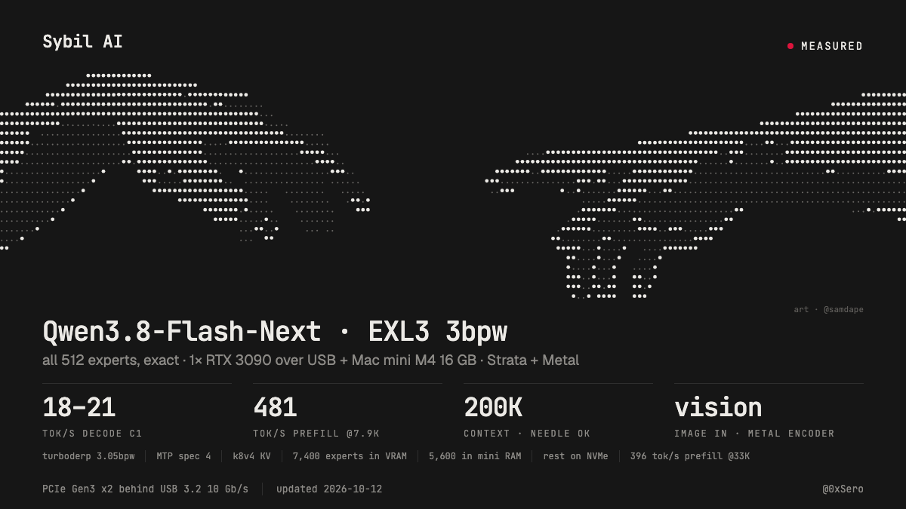

# qwen38-flash-next-3090-usb-offload



Run **Qwen3.8-Flash-Next** (EXL3 3.05 bpw, 48 MoE layers x 512 experts, 45.8 GB of experts, all of them computed, none pruned) with a **200K context**,
**image input** and **MTP speculative decoding** on one **RTX 3090 24 GB attached to a Mac mini M4 (16 GiB) through a USB dock**. The GPU holds the
hottest experts and the attention; the mini computes the other experts on its own GPU (Metal) from an LRU of registered RAM slots and an NVMe drive.
The engine is [Strata](https://github.com/Niko1221/Strata) v0.1.41 plus the patches here, running on macOS through a CUDA-runtime shim ("tgcu") on
tinygrad's NV backend.

## One-click

```sh
docker compose run --rm build      # any machine with Docker (linux/arm64): the pinned CUDA 13.4 build -> ./out (fatbins, patched Strata, configure tree); 3 min cold on an M-series Mac, seconds when cached
docker compose --profile fetch run --rm fetch all    # optional, ~130 GB: experts (sha256-checked against results/pack/exl3_pack.json) + dense GGUF and mmproj (sha256-checked)
./run.sh                           # on the Mac mini: installs the bundle, builds the macOS libraries and the engine, renders the config, starts the server
./run.sh --check                   # the same, without starting the engine or touching USB
```

The serving runtime is native macOS (the engine drives the 3090 over USB through libusb and computes the cold experts with Metal), and Docker on a Mac runs a Linux VM with no Metal and no
USB passthrough of this dock, so Docker makes the build and the model download one command but cannot run the server; `./run.sh` is the one native step. Two Metal binaries need Xcode's Metal toolchain,
which the mini's Command Line Tools lack: `./run.sh --build-metal` builds them on any Mac that has it (into `./out/metal`; copy that directory to the mini). What was run and what was not: [docs/reproduce.md](docs/reproduce.md#10-one-click-what-was-run).

| prefill length | prefill speed | decode speed | kv cache | concurrency |
|---|---|---|---|---|
| 29-35 tokens (3 probe prompts) | TTFT 2.1-2.5 s | **18.2 / 21.4 / 18.1 tok/s** (second run 17.9 / 21.3 / 17.7) | 204,800 (k8v4) | 1 |
| 3,783 | 277 and 334 tok/s | not measured at this length | 204,800 (k8v4) | 1 |
| 7,905 | 428 tok/s cold, 481 tok/s warm | not measured at this length | 204,800 (k8v4) | 1 |
| 17,610 | 407 tok/s | not measured at this length | 204,800 (k8v4) | 1 |
| 33,253 | 396 tok/s | 17.3 tok/s (needle found) | 204,800 (k8v4) | 1 |
| 97,461 | 375 tok/s | 16.5 tok/s (needle found) | 204,800 (k8v4) | 1 |
| 188,835 | 382 tok/s | 13.9 tok/s (needle found) | 204,800 (k8v4) | 1 |

Rows 1-5: config `final-g4-lru-ht` (`configs/strata-exl3-full512-final-g4-lru-ht.json.tmpl`: the LRU config plus the host-tail step), 2026-10-12 07:26-07:34Z, one restart, raw log
[`results/raw/hosttail/ht_final.log`](results/raw/hosttail/ht_final.log); the 33K needle (`meadow-copper-504`) is in the same log. Decode: two warm runs of the three probe prompts right after the restart (greedy, MTP spec 4, c1; code, an
explanation and a story; the second prompt is the one that reaches 21). Prefill: where two numbers are given they are two runs of the same prompt shape with different random first lines (no prefix cache); the 7.9K pair is a
cold and a warm run (the gap is the SSD reads of the first two layers' experts). A later rerun of this config with per-chunk stats switched on reproduces them (decode 18.6 / 21.4 / 17.9; prefill 276 / 326 at 3.8K, 431 cold / 482
warm at 7.9K; [`results/raw/hosttail/ht9_st.log`](results/raw/hosttail/ht9_st.log)); no other change was applied in that run. Rows 97K and 189K were measured on the earlier LRU config
(raw logs `results/raw/g4/lr_g4c_100k.log`, `final_g4.log`) and **not re-run** on this one. The vision encoder is configured, but the vision step of `ht_final.log` aborted (no Pillow in the system Python), so that log holds no
image-answer proof; the earlier image answers (NYT front page photo, a bar chart) are in docs/results.md. Text parity of the host-tail changes (24 greedy tokens at 3.8K and 7.9K, byte-identical): `results/raw/hosttail/ht_ex2_ts150.log`.
Every table with dates and source files: [docs/results.md](docs/results.md).

**What is exact.** The weights: every routed expert of every layer is the turboderp checkpoint's trellis and scale tensors, byte for byte (each layer was range-fetched from the pinned
revision, field-checked, hashed into a sha256 manifest, and 6 experts per layer were re-fetched and byte-compared; nothing pruned, masked or re-quantized), and the 3090 / NEON kernels are
bit-exact (decode) or within 1.1e-3 rel RMS (GEMM; GEMV 5.6e-4) of the exllamav3 reference. **What is rounding-level:**
the fp32 partial-sum split between in-place and missed experts (`STRATA_EXL3_METAL_SPLIT=1`) and the fp16 partial sums of the Mac prefill lane, so greedy text can
differ from a single-pass run after a few hundred characters (coherent, same acceptance). The bit-exact decode variant is ~8-11 % slower. No KL against stock
exllamav3 was measured for this system.

**Gaps against the targets** (18 tok/s decode, 500 tok/s prefill; both revised down from 50 / 1,000 after the full-512 ceiling was measured):

- decode >= 18 tok/s: reached on all three probe prompts in the first run (18.2 / 21.4 / 18.1), on one of three in the second (17.9 / 21.3 / 17.7); 13.9 at 189K context on the earlier config;
- prefill >= 500 tok/s: **not reached**; best 481 (7.9K, warm), 428 cold, 407 at 17.6K, 396 at 33K, 277-334 at 3.8K, 375-382 at 97-189K (earlier config);
- not run: concurrency above 1, GPQA Diamond, tool-calling benchmarks, the 190K needle on the current config.

## Run it

The [One-click](#one-click) flow does all of this; the manual steps below are what `run.sh` and the Docker build automate. You need the hardware below, about 190 GB of free disk on the mini, and a Mac with Xcode's Metal toolchain to build two Metal binaries (the mini's Command Line Tools have none).

| | |
|---|---|
| host | Mac mini M4, 16 GiB, macOS 26.6.2, Command Line Tools 26.6 (SDK 26.5 for builds) |
| GPU | RTX 3090 24 GB in an ASM2464 USB dock (USB 3.2 10 Gb/s, PCIe Gen3 x2), external PSU |
| weights | [turboderp/Qwen3.8-Flash-Next-exl3](https://huggingface.co/turboderp/Qwen3.8-Flash-Next-exl3) branch `3.05bpw_h5_ng5`, revision `69e33439ae950f17bcbe95c98f117d80f759ab6d`; dense part + mmproj from [ISTA-DASLab/Qwen3.8-Flash-Next-GSQ-RCO-GGUF](https://huggingface.co/ISTA-DASLab/Qwen3.8-Flash-Next-GSQ-RCO-GGUF) (IQ3_S); MTP from Qwen/Qwen3.8-Flash-Next `de4b8e4d` |

```sh
git clone https://github.com/Niko1221/Strata ~/strata && git -C ~/strata checkout v0.1.41       # fb58e0dbc839
for p in patches/strata/0*.patch; do git -C ~/strata apply $PWD/$p; done                        # 5 patches, in order
zsh shim/install.sh                                                                             # tgcu shim + libcudart.dylib into ~/shim
cp -R exl3/. ~/exl3/ && cd ~/exl3 && zsh cpu/build.sh                                           # NEON tier
python pack_td.py index && python pack_td.py sync && python pack_td.py verify                   # 45.8 GB of experts, sha256-verified against the pinned revision
# libexl3metal (exl3/metal/build.sh) and strata-vision-metal (vision/build_vision_mac.sh) on a Mac with the Metal toolchain; the engine build: docs/reproduce.md section 5
zsh configs/render.sh configs/strata-exl3-full512-final-g4-lru-ht.json.tmpl > ~/shim/strata-exl3-full512-final-g4-lru-ht.json
zsh ~/shim/ls_srv.sh ~/shim/strata-exl3-full512-final-g4-lru-ht.json                            # ~200 s to ready (campaign notes), http://127.0.0.1:8080/v1
python3 bench/split_probe.py try 300                                                            # decode probe
```

The exact steps, every version actually read from the machine, what was re-run and what was not: [docs/reproduce.md](docs/reproduce.md).
`scripts/verify-card-free.sh` re-runs everything that does not need the card (patch apply, library builds and tests, one layer of the weights fetched and
compared with the manifest). Things that could not be pinned are listed in reproduce.md section 8.

## How it works

```text
  RTX 3090 (24 GB), behind the USB dock                    Mac mini M4 (16 GiB)
  +-------------------------------------------+            +-------------------------------------------------+
  | dense part, attention + GDN, MTP head      |            | Metal lane: LRU of 5,600 mlocked, registered     |
  | 200K k8v4 KV cache                         |  x, ids, w | expert slots (10.46 GB) + 0.2 GiB static tier;   |
  | 7,400 expert slots (12.84 GiB), hottest    | ---------> | computes every expert that is not in VRAM        |
  | experts by profile rank; MoE kernels       |   USB 3.2  | NEON pool = fallback and exact path              |
  | compute them                               | <--------- |                                                 |
  +-------------------------------------------+     y     +----------------------^--------------------------+
                                                                                 | F_NOCACHE preads, ~2.4 GB/s
                                                          +----------------------+--------------------------+
                                                          | NVMe: all 24,576 experts, one 1.86 MB blob each    |
                                                          +-----------------------------------------------------+
```

- **Experts.** 7,400 of 24,576 in VRAM (30 %), 5,600 in the Mac's LRU (23 %), the rest on NVMe. A pick that is in neither is read from NVMe and computed on the Mac; nothing is masked.
- **Decode.** Per layer and verify window, one pre-armed copy-engine pull brings the router output (x rows, expert ids, weights) to the mini, the Metal lane computes the cold experts
  (the ones already in place as one job, the misses read straight into free LRU slots as a second), and one gated push returns the rows plus a flag the GPU waits on. Two USB transactions
  per ring is the floor (0.85 ms); the engine spends about 2.8 ms per ring, 48 rings per window.
- **Prefill.** Cold experts never cross the link: the chunk's fp16 MoE input goes down, the Mac computes the cold (token, expert) pairs with a grouped Metal kernel while the 3090 runs the resident experts, fp16 partial sums come back.
  Four 2,048-token chunks run layer-major in lockstep so each layer's cold blobs are read from NVMe once per group.
- **The USB link** is half duplex and moves 328-353 MB/s one way with the pipelined transfers in `shim/tgcu.py`; there is no CUDA driver for macOS, `shim/` is one (tinygrad boots the GPU, `tgcu` loads cubins and builds launches, `libcudart.dylib` is a drop-in runtime API).
- **Vision.** The mmproj encoder runs on the mini's GPU (llama.cpp mtmd, Metal) and costs no 3090 memory; it is unloaded after 120 idle seconds.

Details and the full settings table: [docs/how-it-works.md](docs/how-it-works.md).

## Where the time goes

Decode, ms per verify window, config `final-g4-lru` (before the host-tail step; the table at the top is after it), `STRATA_DECODE_TIMING=1` (`results/raw/lru/dd_e7.log`; the same prompts on the config before the LRU change are in docs/results.md section 2):

| prompt | tokens/window | ms/window | GPU wait for the ring | cold-expert reads | Metal wait | USB transport (derived) | draft | tok/s |
|---|---|---|---|---|---|---|---|---|
| 1 (code) | 3.33 | 198.9 | 27.6 | 78.0 | 17.9 | 59.4 | 10.1 | 16.7 |
| 2 (explanation) | 2.08 | 109.3 | 17.4 | 16.2 | 6.9 | 54.7 | 8.8 | 19.0 |
| 3 (story) | 1.82 | 114.8 | 17.3 | 17.2 | 12.0 | 54.8 | 8.2 | 15.9 |

Prompt 1 is SSD-bound (78 ms of reads per window here, 88 ms before `MAC_PULL_NOCACHE`, at ~2.4 GB/s; about 8,000 LRU slots would be needed to reach 18 there, and the Metal working-set cap of this mini, 11.84 GiB, stops at ~5,600). Prompts 2 and 3
are bound by the 48 x ~2.8 ms of USB rings plus the GPU's own attention/GDN time, which are floors of this design. Prefill: one chunk-layer costs 96 ms at G=3 (link 58, front 29, host ~8) against the 85 ms that 500 tok/s
needs; prompts of 4K tokens and shorter are SSD-bound (477 MB of cold blobs per layer).

## More

- [docs/results.md](docs/results.md): every table (decode and prefill progressions, memory, receipts, reproducibility checks, exactness) with dates and source files
- [docs/how-it-works.md](docs/how-it-works.md): tiers, rings, LRU, prefill lane, the settings of the final config
- [docs/reproduce.md](docs/reproduce.md): versions, build and run steps, what is and is not pinned
- [docs/troubleshooting.md](docs/troubleshooting.md): link resets, Metal working-set errors, G=4 hangs, build errors
- `patches/` (Strata, tinygrad, vision; history of the per-step diffs), `shim/` (tgcu), `exl3/` (kernels, NEON and Metal libraries, packers, profile), `vision/`, `configs/`, `bench/`, `results/` (raw logs, receipts, campaign ledger), `moetier/` (placement simulator records)

Known issues: the final config's greedy output depends on LRU contents (rounding-level, see above); a restart needs ~200 s (campaign notes) and the first prompts after it read from NVMe; the mini ran at 96 % disk
and had 10.7 of Metal's 12.7 GB working-set cap registered, so a second GPU job or a bigger LRU can fail with `Insufficient Memory`; the USB dock needs a PCIe power cycle after crashes (the shim does it at every start).

Credits: Qwen3.8-Flash-Next by the Qwen team; the [EXL3 checkpoint](https://huggingface.co/turboderp/Qwen3.8-Flash-Next-exl3) and [exllamav3](https://github.com/turboderp-org/exllamav3) kernels (MIT, vendored unmodified
in `exl3/vendor/`) by turboderp; the IQ3_S GSQ-RCO GGUF and mmproj by ISTA-DASLab; [Strata](https://github.com/Niko1221/Strata) (MIT) by Niko1221, patched here; [tinygrad](https://github.com/tinygrad/tinygrad)
(MIT) and the NV-over-USB work of PR #17369; [llama.cpp](https://github.com/ggml-org/llama.cpp) (MIT, vision encoder); SIMDe (MIT); prior art:
[qwen38-flash-next-b70-offload](https://github.com/sybil-solutions/qwen38-flash-next-b70-offload) and [glm-flash-lite](https://github.com/sybil-solutions/glm-flash-lite); card art by @samdape.
MIT license for the code in this repository (patches carry the license of the code they patch); the weights carry their own licenses.
